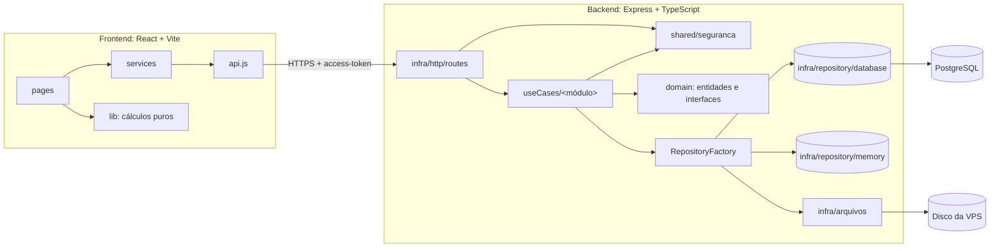

# Revisão de arquitetura (novembro de 2026)

> Revisão dos dois repositórios (backend e frontend) feita na sessão extra 2, depois da fase 4. Diz o que fica como está, o que muda agora e a dívida técnica que fica registrada para depois. As decisões de estrutura estão na [ADR-010](ADR-010_estrutura_por_modulo_e_lint.md).

## Resumo

O sistema está saudável para o tamanho que tem (cerca de 10 mil linhas de TypeScript no backend, 7 mil de JavaScript/CSS no frontend, 80 rotas, 10 módulos). As camadas estão claras, as regras de acesso ficam num lugar só e os testes cobrem os fluxos principais. Os problemas encontrados são de **organização e padronização**, não de desenho: dois estilos de caso de uso convivendo, pastas com nomes em caixas diferentes, nenhum lint e poucos comentários do "porquê".

| Item | Situação | Decisão |
|---|---|---|
| Camadas `domain` → `useCases` → `infra` | Bom | Mantém |
| Casos de uso em dois estilos (um por ação × um por módulo) | Inconsistente | **Agora:** agrupar por módulo |
| Pastas `Entity`, `Interfaces`, `Enum`, `Routes`, `Middleware` ao lado de `seguranca`, `erros` | Inconsistente | **Agora:** tudo em minúsculas |
| Sem lint nem formatação automática | Falta | **Agora:** ESLint + Prettier nos dois repositórios, no CI |
| Poucos comentários do "porquê" (≈4,6% das linhas no backend) | Falta | **Agora:** comentar os pontos-chave |
| Sem licença nos repositórios públicos | Falta | **Agora:** licença proprietária da Konvex Jr. |
| Erro inesperado vira 422 com a mensagem da exceção | Risco baixo | Depois (opcional) |
| 229 usos de `any`, quase todos nas assinaturas das rotas | Dívida | Depois (regra do lint desligada até tipar as rotas) |
| Helpers de texto/lista repetidos em três arquivos | Dívida | Depois |
| Dependências com versão maior nova (Express 5, TypeScript 7, React 19, Vite 8) | Dívida | Depois, em sessão própria |
| `components.css` com 1.469 linhas | Dívida | Depois |

## 1. Visão geral



- **Monólito modular** (ADR-001 da especificação, mantida). Um processo Node, um banco, um frontend estático.
- **Registro único de módulos** (`source/modulos/registro.ts`): cada módulo declara rotas, permissões e item de menu. O `Router` monta tudo a partir dele e `GET /auth/permissoes` devolve o menu de cada pessoa. É o ponto mais forte do desenho: módulo novo não esquece de registrar permissão nem menu.
- **Permissões em dois níveis:** por papel (`catalogoPermissoes.ts`) e por item (`regras*.ts`, `sigiloPastas.ts`, `visibilidadeProjetos.ts`). A API devolve booleanos prontos (`podeAlterar`, `podeGerir`) e o frontend só obedece; a regra nunca é duplicada na tela.
- **Repositórios com duas implementações** (memória e banco) atrás de uma interface e de uma factory. Os testes unitários e HTTP rodam em memória, em segundos; os de integração rodam contra PostgreSQL real.

## 2. Backend

### O que fica
- **SQL direto com `pg`, sem ORM.** As consultas são poucas e legíveis; um ORM agora custaria mais do que entrega.
- **Validação na borda e na entidade.** A rota converte tipos (`shared/entradas.ts`); a entidade garante as regras de valor. Erros de entrada viram 400 com o campo errado na mensagem (`mensagensDeErro.ts`).
- **Leituras simples direto no repositório dentro da rota** (18 ocorrências, como `GET /projetos/:codigo`). É aceitável para "buscar por código e conferir acesso". **Convenção:** toda escrita passa por um caso de uso.
- **Swagger escrito à mão** (`swagger.ts`). O teste `swaggerRoutes.test.ts` falha se uma rota não estiver documentada, o que segura a desatualização.
- **Migrações SQL numeradas**, aplicadas na subida. Simples e auditáveis.

### O que muda agora (PR de estrutura)
1. **Casos de uso agrupados por módulo**, com os nomes dos módulos do registro (mais `auth`, que não é módulo de menu):

   ```
   source/useCases/
     auth/          LoginUsuario, AlterarSenha, RenovarSessao, EncerrarSessao, emitirSessao
     pessoas/       CriarUsuario, EditarUsuario, InativarUsuario, ListarUsuarios, AlterarStatusPessoa, ObterPerfilPessoa
     config/        SalvarArea, SalvarCargo, SalvarSenioridade
     projetos/      CriarProjeto, EditarProjeto, ExcluirProjeto, AlternarStatusProjeto, ListarProjetos, Equipe
     tarefas/       CriarTarefa, EditarTarefa, ExcluirTarefa, AlterarStatusTarefa, ListarTarefas
     documentos/    CriarPasta, RenomearPasta, ExcluirPasta, ListarPastas, EnviarDocumento, RenomearDocumento, ExcluirDocumento, ListarDocumentos
     conhecimento/  SalvarConhecimento
     iniciativas/   SalvarIniciativa
     anexos/        GerirAnexos
     capacitacoes/  GerirCapacitacoes
   ```

   As classes continuam as mesmas (uma por operação nos módulos antigos). Fundir `CriarProjeto` + `EditarProjeto` + … numa classe `GerirProjetos` mudaria a assinatura de dezenas de testes sem ganho para quem lê; o que confundia era **onde procurar**, e isso o agrupamento resolve. Módulo novo continua nascendo com um caso de uso só (`Salvar*`/`Gerir*`).
2. **Pastas em minúsculas:** `domain/entity`, `domain/enum`, `domain/interfaces`, `domain/service`, `infra/http/routes`, `infra/http/middleware`. Os nomes dos arquivos (classes) não mudam.

### Dívida registrada (para depois)
- **Erro inesperado responde 422 com `exception.message`** (`ExpressHttp.responderErro`). Um `TypeError` interno chegaria à tela com texto técnico. O certo é 500 com mensagem genérica e o detalhe só no log. Muda comportamento, então vai num PR próprio, com teste.
- **`any` nas rotas.** A assinatura `Http.route(..., callback: any)` espalha `any` por todas as rotas. Tipar o callback (`(params, body, query) => Promise<unknown>`) reduziria quase todos os 229 usos. A regra `no-explicit-any` fica desligada no lint até isso ser feito.
- **Helpers repetidos.** `lerTexto` (SalvarConhecimento), `texto`/`lista` (SalvarIniciativa) e `texto` (IniciativaRoutes) fazem quase o mesmo, mas com diferenças de `trim`. Consolidar em `shared/entradas.ts` exige cuidado com essas diferenças.
- **Listagens que carregam tudo e filtram em memória** (ex.: `tarefasDaIniciativa`, pastas do projeto no `ExcluirProjeto`). Ok para o volume atual (dezenas de pessoas, centenas de itens); revisitar se alguma tela ficar lenta.
- **Achados da leitura do código (sessão extra 2), a corrigir em PRs próprios, com teste:**
  - Inscrição em capacitação: a conferência de vaga no mesmo comando SQL não impede, em READ COMMITTED e sem lock, que duas inscrições simultâneas passem do limite (risco baixo).
  - Datas de "hoje": `dataParaSql(new Date())` grava o dia em UTC (depois das 21h em São Paulo vira o dia seguinte); `Conhecimento.hoje()` usa UTC e `Participacao.hoje()` usa o fuso local.
  - E-mail duplicado responde 400 ao criar pessoa e 409 ao editar.
  - Repositórios antigos (tarefa, documento, pasta) lançam `Error` genérico para "não encontrado", que vira 422 em vez de 404; e comparam `codigo = $1`, então um código fora do formato UUID vira 500 (os novos usam `codigo::text = $1` e respondem 404).
  - Mensagens: `SENIORIDADE_OBRIGATORIA` diz "todos os perfis", mas a regra só exige de membro; `LoginUsuario` não usa `MENSAGENS_DE_ERRO.AUTENTICACAO.CREDENCIAIS_INVALIDAS`.
  - Checklist da tarefa sem ordem garantida (sem coluna de ordem nem `ORDER BY`).
  - `lerInteiro` aceita decimais (`1.5`).
- **Atualizações maiores de dependências:** Express 5, TypeScript 7, dotenv 18, uuid 14. Nenhuma vulnerabilidade conhecida hoje (`npm audit`: 0).

## 3. Frontend

### O que fica
- **`services/<módulo>.js` + página com `useCarregar`**: padrão simples, repetido em todas as telas.
- **`api.js` centraliza sessão, renovação do token e mensagens de erro.** Uma renovação por vez; 401 repetido limpa a sessão.
- **Cálculos puros em `lib/`, com teste** (`node --test`, sem framework).
- **Responsivo só em `responsive.css`** e permissões vindas da API.
- **Páginas com `lazy()`** e orçamento de tamanho no CI (sessão de desempenho).

### O que muda agora
- **ESLint + Prettier** (com regras de React e de hooks) no CI.
- **Comentários** nos pontos que quem chega precisa entender: `api.js`, `useCarregar`, `carregarPagina`, `AppContext`, `Layout`, `Table`, `alerts` e os services.

### Dívida registrada (para depois)
- **`components.css` com 1.469 linhas.** Dividir por componente quando alguém mexer pesado no visual.
- **Páginas grandes** (`Capacitacoes.jsx` 325 linhas, `Precificacao.jsx` 270). Extrair partes quando forem alteradas.
- **Testes só em `lib/`.** As telas são cobertas pelo levantamento no navegador (`npm run e2e`), que ainda roda à mão (fase 5 leva para o CI).
- **Achados da leitura do código (sessão extra 2), a corrigir em PRs próprios:**
  - O progresso do projeto (`prog` em `lib/utils.js`) é calculado sobre as tarefas carregadas; para o membro, que só recebe as próprias, o % difere do que a gestão vê.
  - Calendário de capacitações abre no mês de `new Date().toISOString()` (UTC): no último dia do mês, depois das 21h, abre no mês seguinte.
  - `useCarregar` não ignora respostas antigas: com filtros mudando rápido (Base, Iniciativas), uma resposta lenta pode sobrescrever a lista.
  - "Hoje" (`D.c.hoje`) só é recalculado no login, no F5 ou depois de salvar; aba aberta de um dia para o outro mostra atrasos do dia anterior.
  - Código sem uso: `nid` e `semana` em `lib/utils.js`; `NAV` só serve para o `path` (o menu vem da API).
  - `FormModal`: select sem valor inicial mostra a primeira opção, mas o valor fica vazio até a pessoa trocar (as telas atuais passam valor inicial).
- **React 19 e Vite 8** disponíveis; atualizar em sessão própria.

## 4. Convenções que esta revisão confirma

| Tema | Convenção |
|---|---|
| Caso de uso | Em `useCases/<módulo>/`. Módulo novo: um caso de uso (`Salvar*`/`Gerir*`) |
| Escrita | Sempre por caso de uso; a rota só converte entrada e confere permissão |
| Leitura simples | Pode ir direto ao repositório, sempre conferindo o acesso ao item |
| Erros | `ErroValidacao` 400, `ErroProibido` 403, `ErroNaoEncontrado` 404, `ErroConflito` 409; mensagem diz o campo |
| Comentários | Explicam o **porquê** (regra de negócio, decisão, armadilha), não repetem o código |
| Formatação | Prettier decide; ninguém discute estilo em PR |
| Licença | Proprietária da Konvex Jr. (`LICENSE`); repositório público só para leitura |
